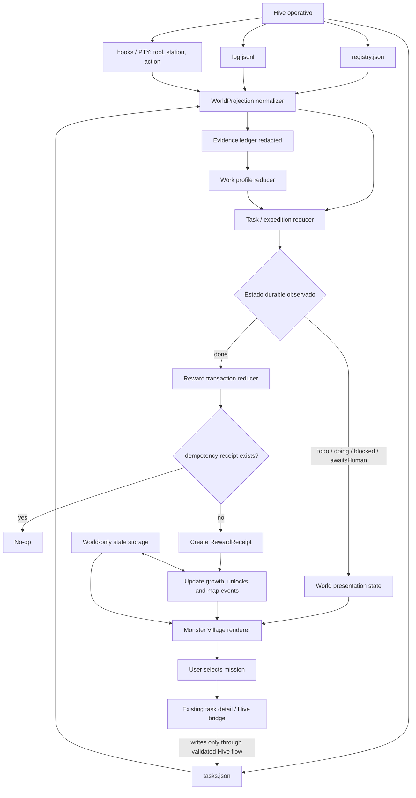

# Monster Village: arquitectura de expediciones y evolución

**Estado:** propuesta de diseño v0.1  
**Producto:** ISyCo Worlds  
**Mundo:** Monster Village  
**Audiencia:** ingeniería, diseño de juego y producto

## 1. Intención del diseño

Monster Village no debe convertirse en otra sidebar de productividad. Munder Difflin ya ocupa el espacio de oficina, tareas, inbox, memoria, automatizaciones, capacidades, IDE, integraciones y equipos. Monster Village debe diferenciarse por convertir el trabajo real del Hive en un mundo persistente: una tarea se vuelve una expedición, la evidencia de trabajo define el hábitat del monstruo y una transición durable puede cambiar el mapa.

Los tres pilares son:

1. **Misión → expedición → cambio visible del mapa.** El backlog sigue siendo real, pero su representación principal es una expedición con destino, obstáculos y recompensa.
2. **Trabajo real → especialización → evolución.** La evolución depende de herramientas, estaciones y resultados durables observados; no depende de leer una frase del agente ni de inventar éxito.
3. **Estado real → incidente visual → decisión humana.** Un bloqueo, una solicitud humana o un error persistente produce un evento legible en el mundo, pero nunca oculta el estado operativo original.

## 2. Frontera de autoridad

El sistema tiene tres planos. La separación es obligatoria, no una preferencia de implementación.

### 2.1 Plano operativo: Hive

Hive es la fuente de verdad de ejecución. Incluye, entre otros:

- `registry.json`: roster, identidad, rol, capacidades y estado del agente.
- `tasks.json`: tareas, asignación, estado, dependencias y referencias de resultado.
- `log.jsonl`: eventos append-only con timestamps.
- hooks y PTY: estación, herramienta, acción y actividad live.

Monster Village puede **leer y proyectar** estos datos. No puede cambiar una tarea, asignar un agente, pausar un proceso ni declarar éxito. Las acciones de usuario siguen usando el flujo existente de detalle y el bridge validado de Hive.

### 2.2 Plano de contenido: definición authored

El contenido del juego es estático y versionado con la aplicación. Define:

- biomas y estaciones;
- tipos de expedición;
- rutas y obstáculos;
- especies, etapas y formas visuales;
- reglas de recompensa;
- eventos visuales permitidos.

No contiene nombres de agentes, títulos de tareas ni resultados runtime.

### 2.3 Plano de estado del mundo: simulación local

El estado de juego vive aparte, por ejemplo en:

```text
<world-storage>/monster-village/world-state.v1.json
```

En el primer vertical slice puede persistirse en `localStorage` del world renderer. Más adelante puede moverse a un archivo del main process con un bridge reducido. Nunca debe mezclarse con `hive/tasks.json`.

Este plano guarda el reloj de simulación, el descubrimiento de biomas, las expediciones observadas, los recibos de recompensa y la evolución. Su semántica es local: pausar el mundo solo pausa animaciones y reloj, no agentes.

## 3. Modelo de datos

Los siguientes tipos son contratos conceptuales. Los nombres pueden adaptarse a TypeScript, pero las relaciones y las garantías deben permanecer.

### 3.1 Catálogo authored de biomas

```ts
type BiomeId =
  | 'village'
  | 'research-grove'
  | 'forge-mines'
  | 'testing-sanctum'
  | 'review-tower'
  | 'blockade-swamp'
  | 'professor-gate'
  | 'release-harbor';

type BiomeKind = 'home' | 'work' | 'risk' | 'human-gate' | 'milestone';

type WorldAnchorId = string;

interface BiomeDefinition {
  id: BiomeId;
  nameKey: string;
  kind: BiomeKind;
  anchorId: WorldAnchorId;
  allowedWorkTypes: WorkType[];
  requiredUnlocks: string[];
  visualState: {
    idleAsset: string;
    activeAsset: string;
    blockedAsset?: string;
  };
}
```

Biomes son lugares visuales y semánticos. `allowedWorkTypes` no determina lo que el agente está haciendo; sirve para elegir una representación cuando la evidencia runtime coincide.

Propuesta inicial:

- `village`: punto de partida, roster y tareas sin destino especializado.
- `research-grove`: `Read`, `Grep`, `Glob`, `WebFetch`, `WebSearch` y estaciones `shelf`, `web`, `mcp`.
- `forge-mines`: `Edit`, `Write`, `Bash` cuando el trabajo es implementación o modificación.
- `testing-sanctum`: pruebas, validación y comandos de test observados en `Bash`.
- `review-tower`: revisión, comparación o inspección de cambios.
- `blockade-swamp`: representación de `blocked`, error storm o loop breaker.
- `professor-gate`: `awaitsHuman`, permiso, decisión o pregunta que requiere intervención.
- `release-harbor`: una expedición de release o integración completada con evidencia explícita.

### 3.2 Perfil de trabajo observado

El perfil no se deduce principalmente del título de la tarea. Se calcula a partir de eventos estructurados de hook/PTY y se mantiene como evidencia con confianza.

```ts
type WorkType =
  | 'research'
  | 'implementation'
  | 'testing'
  | 'review'
  | 'coordination'
  | 'release'
  | 'unknown';

type EvidenceKind = 'hook' | 'station' | 'tool' | 'task-transition' | 'log';

interface WorkEvidence {
  id: string;
  observedAt: number;
  agentId: string;
  taskId?: string;
  kind: EvidenceKind;
  tool?: string;
  station?: string;
  workType: WorkType;
  weight: number;
  source: 'Hive hook' | 'Hive registry' | 'Hive tasks.json' | 'Hive log';
}

interface WorkProfile {
  primary: WorkType;
  scores: Partial<Record<WorkType, number>>;
  confidence: 'high' | 'medium' | 'low';
  evidenceIds: string[];
  observedAt: number;
}
```

Reglas recomendadas:

- Una estación o herramienta conocida aporta peso alto.
- Una transición de tarea aporta contexto, pero no cambia por sí sola la especialización.
- Un título de tarea puede aportar una señal de baja confianza, solo para colorear la escena.
- Un texto del agente nunca puede producir una recompensa o una evolución por sí solo.
- Si la confianza es baja, se muestra `unknown` o una zona neutral; no se inventa un bioma.

Ejemplo de pesos iniciales:

```json
{
  "Read": { "research": 3 },
  "Grep": { "research": 3 },
  "Glob": { "research": 2 },
  "WebFetch": { "research": 3 },
  "WebSearch": { "research": 3 },
  "Edit": { "implementation": 3 },
  "Write": { "implementation": 3 },
  "Bash": { "implementation": 1, "testing": 1, "release": 1 },
  "TodoWrite": { "coordination": 2 },
  "terminal:test-command": { "testing": 3 },
  "review-diff": { "review": 3 }
}
```

### 3.3 Proyección de tarea a expedición

Una expedición es una vista de mundo de una tarea o un grupo explícito de tareas. No reemplaza el registro de Hive.

```ts
type ExpeditionStatus =
  | 'unassigned'
  | 'staging'
  | 'active'
  | 'blocked'
  | 'awaiting-human'
  | 'complete'
  | 'failed'
  | 'archived';

type ExpeditionObjective = {
  id: string;
  label: string;
  taskIds: string[];
  parentTaskId?: string;
};

interface ExpeditionProjection {
  id: string;
  source: 'Hive task' | 'Hive task group';
  taskIds: string[];
  objective: ExpeditionObjective;
  assigneeIds: string[];
  status: ExpeditionStatus;
  currentBiome: BiomeId;
  workProfile: WorkProfile;
  dependencyIds: string[];
  completedAt?: number;
  lastObservedAt: number;
  evidenceRevision: string;
}
```

La primera versión puede usar `expedition:<taskId>` como identidad estable. Las expediciones agrupadas se habilitan cuando Hive tenga una relación explícita de parent/dependency o cuando el usuario cree el grupo desde una UI de mundo. No se agrupan tareas por similitud de texto automáticamente.

### 3.4 Estado de evolución del monstruo

```ts
type EvolutionStage = 'baby' | 'middle' | 'final';

type GrowthTrack =
  | 'research'
  | 'craft'
  | 'guardian'
  | 'mentor'
  | 'runner'
  | 'balanced';

interface MonsterGrowthState {
  agentId: string;
  speciesId: string;
  stage: EvolutionStage;
  track: GrowthTrack;
  progress: number;
  completedExpeditionCount: number;
  workTotals: Partial<Record<WorkType, number>>;
  rewardReceiptIds: string[];
  lastChangedAt?: number;
  version: 1;
}
```

La especie visual puede seguir siendo estable por agente. La forma o el track cambia según `workTotals` y los umbrales authored. Esto evita que el sistema parezca un cambio aleatorio de sprite.

### 3.5 Recibo de recompensa

```ts
interface RewardReceipt {
  id: string;
  idempotencyKey: string;
  taskId: string;
  expeditionId: string;
  agentId?: string;
  rewardKind: 'growth' | 'biome-unlock' | 'structure' | 'cosmetic' | 'reputation';
  amount: number;
  sourceStatus: 'done';
  sourceObservedAt: number;
  sourceRevision: string;
  createdAt: number;
}
```

`idempotencyKey` debe derivar de una transición durable, no de cada render. Una forma inicial es:

```text
reward:<taskId>:done:<sourceRevision>
```

Si el mismo snapshot llega diez veces, se conserva un solo recibo. Si el renderer se reinicia, el recibo evita duplicar progreso. Si la tarea vuelve a `doing` y después a `done`, el producto debe elegir explícitamente si es el mismo completion o un nuevo ciclo; el MVP conserva el primer recibo por `taskId` para evitar inflación accidental.

## 4. Máquina de estados tarea → mundo

La tarea mantiene su estado real. El mundo deriva un estado visual con más semántica.

| Estado Hive observado | Estado de expedición | Bioma visual | Efecto permitido |
|---|---|---|---|
| `todo`, sin agente | `unassigned` | `village` / tablero | Mostrar misión disponible |
| `todo`, con agente | `staging` | `village` / campamento | Mostrar entrenador preparándose |
| `doing` + evidencia de investigación | `active` | `research-grove` | Caminar, herramienta y estación de investigación |
| `doing` + implementación | `active` | `forge-mines` | Actividad de forja y progreso visual |
| `doing` + pruebas | `active` | `testing-sanctum` | Mostrar validación y señales de test |
| `doing` + revisión | `active` | `review-tower` | Mostrar inspección o vigilancia |
| `blocked` | `blocked` | `blockade-swamp` | Barrera, niebla y acción de desbloqueo |
| `awaitsHuman: true` | `awaiting-human` | `professor-gate` | Profesor/monstruo espera al usuario |
| `done` | `complete` | bioma de destino → santuario | Recompensa, recibo y posible evolución |
| salida o error definitivo | `failed` | `blockade-swamp` | Evento de incidente, nunca recompensa |

`done` no implica que una expedición haya producido un artefacto específico. Solo habilita la recompensa definida para ese objetivo. Un commit, PR o archivo se puede mostrar únicamente si existe una referencia real en Hive o Git.

## 5. Flujo de datos



### 5.1 Reducer principal

```ts
function reduceWorldFrame(
  previous: WorldState,
  input: CanonicalHiveSnapshot,
  authored: WorldContent
): WorldState {
  const evidence = collectEvidence(input);
  const profiles = reduceWorkProfiles(previous.profiles, evidence);
  const expeditions = reduceExpeditions(previous.expeditions, input.tasks, profiles, authored);

  const completionCandidates = findNewDoneTransitions(
    previous.expeditions,
    expeditions,
    input.revision
  );

  let next = { ...previous, profiles, expeditions };
  for (const candidate of completionCandidates) {
    next = applyRewardIfNew(next, candidate, authored);
  }

  return advanceWorldClock(next);
}
```

Garantías del reducer:

- Es puro desde la perspectiva de Hive: no llama a `hivePatchTask`, `hiveAddTask` ni a ningún mutador.
- Es idempotente para el mismo `input.revision`.
- No usa el texto de una respuesta del agente como prueba de completion.
- No crea progreso cuando una tarea solo se renderiza varias veces.
- Produce cambios visuales explicables con `source`, `observedAt` y `evidenceIds`.

## 6. Sistema de evolución por trabajo real

### 6.1 Tracks

| Track | Evidencia dominante | Fantasía visual | Evolución propuesta |
|---|---|---|---|
| `research` | `Read`, `Grep`, `Glob`, web, MCP de consulta | explorador, mapas, prismas | `Pipfern → Thornbloom → Canopy Warden` o equivalente authored |
| `craft` | `Edit`, `Write`, cambios persistentes | forja, herramientas, armadura | forma de artesano |
| `guardian` | tests, validaciones, checks repetidos | escudo, runas, barreras | forma de guardián |
| `mentor` | asignación, revisión, coordinación | estandartes, señales | forma de guía |
| `runner` | releases, CI, transporte entre biomas | alas, rutas, mensajeros | forma de mensajero |
| `balanced` | señales distribuidas sin dominante | mezcla estable | evolución equilibrada |

Los nombres y sprites son parte del catálogo authored. El track describe la razón de la evolución, no una afirmación sobre la calidad del trabajo.

### 6.2 Umbrales sugeridos

Para evitar que un solo `PostToolUse` cambie toda la identidad:

- `baby`: estado inicial.
- `middle`: una expedición `done` atribuida al agente y al menos 3 puntos de evidencia en un track.
- `final`: tres expediciones `done` o 10 puntos ponderados en el track dominante.
- `balanced`: si ningún track supera el 55% del total después de tres expediciones.

El progreso se registra como estado de juego. No altera el rol, modelo, permisos ni capacidades del agente.

### 6.3 Recompensas

Una tarea `done` puede producir una o más recompensas authored:

- crecimiento del monstruo;
- desbloqueo de un bioma;
- construcción de una estructura;
- objeto cosmético;
- reputación de la aldea;
- acceso a una ruta visual nueva.

El MVP debe comenzar con **una recompensa por tarea completada** y un límite claro. No conviene introducir loot aleatorio, monedas o una economía antes de validar que la relación entre trabajo y cambio visual es legible.

## 7. GDD simplificado

### 7.1 Nombre y pitch

**Monster Village: Expediciones de un equipo vivo**

Monster Village es un mundo visual dentro de ISyCo Worlds donde agentes reales aparecen como entrenadores y monstruos. El usuario observa trabajo auténtico, selecciona misiones mediante los flujos existentes y ve cómo las expediciones completadas hacen crecer la aldea.

### 7.2 Experiencia objetivo

La experiencia debe responder tres preguntas sin abrir un terminal:

1. ¿Quién está trabajando y en qué tipo de lugar?
2. ¿Qué misión necesita atención o está bloqueada?
3. ¿Qué cambio real produjo el último trabajo completado?

El mundo debe ser interesante incluso cuando nadie necesita intervención, pero no debe inventar actividad para parecer vivo.

### 7.3 Bucle principal

```text
Observar estado real
  → elegir una misión
  → abrir el detalle existente o enviar la instrucción aprobada
  → seguir la expedición por biomas
  → resolver un bloqueo si aparece
  → observar transición durable a done
  → recibir recompensa de mundo
  → evolucionar monstruo / desbloquear mapa
  → preparar la siguiente expedición
```

### 7.4 Rol del jugador

El jugador es el **Profesor**. No controla cada movimiento ni juega un RTS. Sus decisiones son:

- elegir qué misión observar o abrir;
- decidir cuándo intervenir en una solicitud humana;
- elegir qué estructura o ruta desbloqueada priorizar;
- organizar visualmente la aldea;
- leer el historial de por qué evolucionó un monstruo.

El jugador no puede convertir una tarea en `done` desde la simulación. Tampoco puede obtener recompensas por pulsar botones visuales.

### 7.5 Estados emocionales y lectura visual

- **Preparación:** el equipo se reúne en el campamento.
- **Exploración:** el monstruo se desplaza al bioma compatible con su evidencia.
- **Tensión:** una barrera o puerta muestra `blocked` o `awaitsHuman`.
- **Resolución:** una transición durable desbloquea el siguiente estado.
- **Celebración contenida:** la recompensa cambia el mundo sin saturar la interfaz.
- **Memoria:** el usuario puede explicar la evolución viendo sus recibos de procedencia.

### 7.6 UI principal

El HUD debe tener cuatro capas, en este orden:

1. **Hive operativo:** agentes, estado, estación, herramienta y fuente.
2. **Backlog/expediciones:** tareas reales, agrupación explícita y filtros.
3. **Misión seleccionada:** objetivo, propietario, estado, dependencias y botón de detalle existente.
4. **Simulación:** reloj, velocidad, pausa, recompensas y evolución. Debe llevar una etiqueta visible de `solo mundo`.

La actividad reciente debe mostrar qué cambió, cuándo se observó y de qué fuente provino. Los cuerpos de mensajes, prompts, entradas de herramientas y rutas no deben aparecer en este registro resumido.

### 7.7 Contenido inicial de lanzamiento

Para el primer lanzamiento de esta propuesta:

- 6 a 8 biomas authored.
- 4 tracks de evolución activos: `research`, `craft`, `guardian`, `mentor`.
- 3 etapas visuales por especie ya existentes.
- 1 recompensa por tarea `done`.
- 1 evento visual para bloqueo y 1 para solicitud humana.
- expediciones 1:1 por tarea; agrupación explícita después.
- reloj y velocidad locales, sin impacto operativo.
- registro de procedencia de cada evolución.

### 7.8 Lo que no se debe hacer todavía

- No crear una economía de monedas.
- No inventar artefactos, commits o PRs que Hive no reportó.
- No clasificar tareas solo por título libre.
- No hacer que una pausa del mundo pause agentes reales.
- No convertir Monster Village en un duplicado de la sidebar Pro.
- No añadir combate que requiera atención constante si el producto sigue siendo un observador de trabajo.
- No mezclar recompensas con permisos, modelos o presupuesto operativo.

## 8. Roadmap técnico

### Fase A — Proyección segura

1. Formalizar `WorkEvidence`, `WorkProfile` y `BiomeDefinition`.
2. Exponer `station`, `tool`, `source` y `observedAt` desde la proyección actual.
3. Crear `expedition:<taskId>` para cada tarea real.
4. Añadir pruebas de idempotencia y de no escritura en Hive.

### Fase B — Primer loop jugable

1. Crear `WorldStateV1` en almacenamiento separado.
2. Añadir `RewardReceipt` con deduplicación por tarea.
3. Conectar `done` durable con una recompensa simple.
4. Mostrar una evolución con recibo de procedencia.
5. Desbloquear un bioma authored después de un umbral pequeño.

### Fase C — Expresividad

1. Añadir perfiles de trabajo con pesos por herramienta/estación.
2. Añadir eventos para bloqueos, solicitudes humanas y errores persistentes.
3. Añadir agrupaciones explícitas de expediciones.
4. Añadir estructuras que cambian la lectura del mapa.

### Fase D — Persistencia y colaboración entre mundos

1. Mover el almacenamiento world-only al main process mediante bridge mínimo.
2. Versionar migraciones de `WorldStateV1`.
3. Modelar aldeas conectadas como rutas de expedición entre computadoras.
4. Añadir exportación de un diario visual sin exponer cuerpos de mensajes ni secretos.

## 9. Métricas de validación

La propuesta funciona si:

- una persona puede identificar el estado real del equipo en menos de cinco segundos;
- puede explicar por qué un monstruo evolucionó mirando sus recibos;
- repetir el mismo snapshot no duplica recompensas;
- pausar el mundo no cambia ninguna tarea ni proceso de Hive;
- el usuario puede abrir una misión y continuar usando el flujo existente;
- los estados desconocidos degradan a una representación neutral, no a una afirmación falsa;
- Monster Village se siente como un mundo con progresión, no como una copia decorada del panel Pro.

## 10. Referencias de contexto

La separación propuesta responde a la superficie pública actual de Munder Difflin, que concentra Pro en un workspace/sidebar con tareas, inbox, automatizaciones, memoria, capacidades, integraciones, equipos, Stapler e IDE. Monster Village debe diferenciarse por la capa de mundo y progresión, no por duplicar esas herramientas.

- [Munder Difflin — producto y planes](https://munderdiffl.in/)
- [Munder Difflin — repositorio y capacidades](https://github.com/HarnessMD/munder-difflin)
- [Munder Difflin 0.5.2 — Pro y Stapler](https://munderdiffl.in/blog/launching-munder-difflin-v0-5-2/)
- [ISyCo Worlds — contrato Hive](../../HIVE.md)
- [ISyCo Worlds — especificación de runtime](../../SPEC.md)
